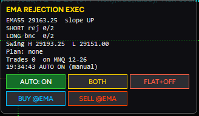

# NinjaTrader Strategies

Automated trading strategies for [NinjaTrader 8](https://ninjatrader.com/), written in C# (NinjaScript).

| Strategy | What it does |
|---|---|
| [EmaRejectionExecution](Strategies/EmaRejectionExecution.cs) | Detects price rejecting (or bouncing off) an EMA with lower-high / higher-low structure, then works a limit order that rides the EMA, with an on-chart dashboard and an AUTO on/off switch. |

> **Disclaimer:** this is personal project code shared for educational and portfolio purposes. It is not financial advice. Futures trading carries substantial risk of loss. Test in a simulation account first.

---

## EmaRejectionExecution

Built for NQ / MNQ index futures on fast execution charts (377-tick, 1-min, 3-min). It reads the signal from one instrument and can execute on another, e.g. NQ data with orders on the MNQ micro contract.

### Setup detection

**Short (rejection):**
1. **Test:** a bar's high reaches the EMA. It is still a test when:
   - the wick goes through the EMA by up to *Max wick pierce*, or
   - the bar closes over the EMA by up to *Close-over tolerance*.
2. **Rejection:** within a few bars, a bar closes back under the EMA by at least *Reject close*.
3. **Setup:** *Required rejections* (default 2) in a row, each with a **lower high** than the last.
4. **Invalidation:** any of these cancels the setup:
   - a close over the EMA beyond the tolerance
   - a wick through it beyond the max pierce
   - too many closes in a row over the EMA
   - the rejections getting older than the lookback

**Long (bounce)** is the mirror image, with bounces making **higher lows**.

### Order management

| | Behaviour |
|---|---|
| **Entry** | Limit at EMA − offset (short) / EMA + offset (long). It is moved with the EMA every bar, and only placed while it can rest a minimum distance away from the market, so it never fills instantly. |
| **Stop** | Fixed points from the fill (default 25). |
| **Target** | The setup's lower low (short) / higher high (long) plus a buffer, never closer than a minimum R-multiple (default 1:1). It extends with the leg, and once you move it by hand the strategy leaves it alone. |
| **Profit lock** | At +30 pts the stop moves to +12 pts (both configurable). |
| **Automation** | Stays armed and takes every new setup until a full stop-loss hit (configurable), or until you switch it off. |

### Dashboard

A panel on the chart shows:
- the EMA value and slope
- the rejection / bounce count on each side, with its structure
- the planned entry, stop, target and R:R
- the order status and the last event

The buttons are:
- **AUTO ON/OFF**
- **Direction** (Both / Long / Short)
- **FLAT+OFF**: cancels the order, closes the position and turns AUTO off
- **BUY @EMA / SELL @EMA**: forces a setup on that side

### Design notes

- **No repainting.** Setup logic runs only on closed bars. The bar index is offset correctly between historical and realtime processing, so backtest and live behaviour match.
- **Multi-instrument execution.** Orders are routed to a secondary data series. *Execute on micro* maps NQ→MNQ, ES→MES and so on, keeping the contract month.
- **Managed orders.** Per-entry stops and targets. The live target is updated with `SetProfitTarget`, and a manual change to it is detected in `OnOrderUpdate`.
- **Thread-safe UI.** The WPF controls are updated through the chart dispatcher. Button clicks are routed into the strategy's own thread with `TriggerCustomEvent`.
- **Safe defaults.** It starts disarmed, only trades on realtime data when on a chart, and is always armed in the Strategy Analyzer so it can be backtested.

### Install

1. Copy `Strategies/EmaRejectionExecution.cs` to `Documents\NinjaTrader 8\bin\Custom\Strategies\`.
2. In NinjaTrader, open **New → NinjaScript Editor** and press **F5** to compile.
3. Add it to a chart: **right-click → Strategies → EmaRejectionExecution**. Use a **Sim101** account first.

### Testing approach

1. **Watch mode** (AUTO off): check that the setup markers match a manual read of the chart.
2. **Market Replay (Playback):** check order placement, EMA tracking, cancellation, the profit lock and auto-disarm.
3. **Strategy Analyzer:** backtest on tick data with high fill resolution.
4. **Live Sim101** before any funded account.

---

## Development workflow

- `main`: stable, tested releases (tagged, e.g. `v1.0.0`).
- `develop`: where finished features are combined and tested.
- `feature/<name>`: one branch per change, merged into `develop` through a reviewed pull request.

Both `main` and `develop` are protected, so changes land only through pull requests.

## License

[MIT](LICENSE)
